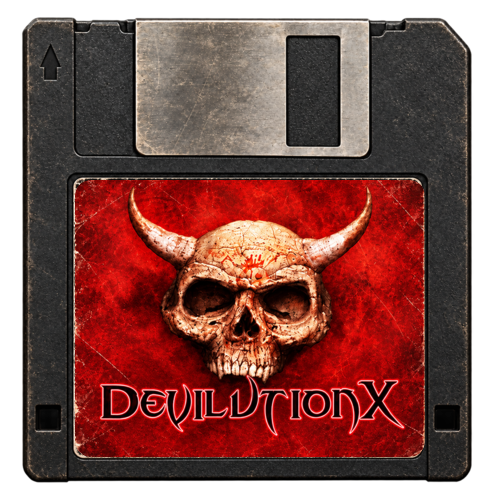
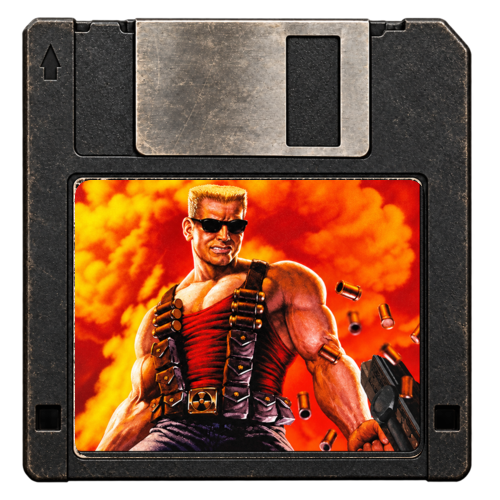
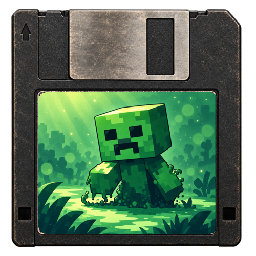
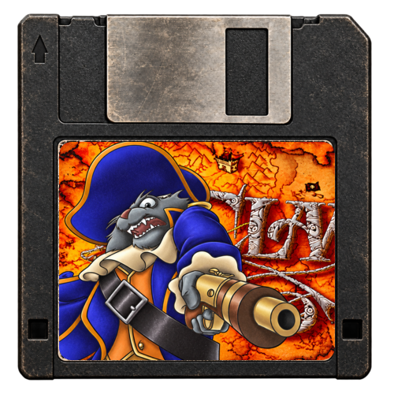
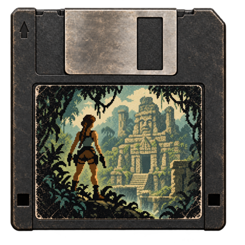
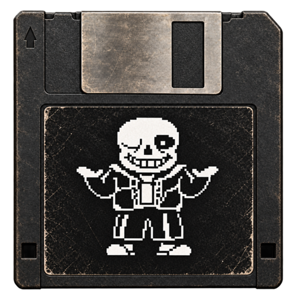
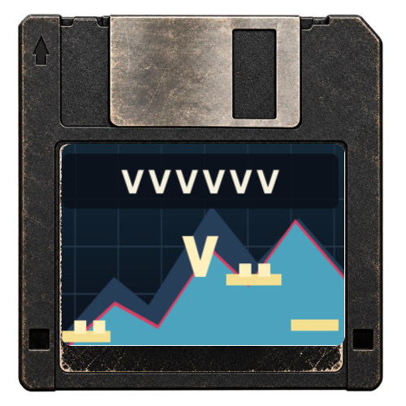

# TreeFrogUI Ports Collection

This repository distributes standalone game ports for TreeFrogUI devices. Each
port has its own folder under `ports/`, with its launcher metadata, executable
or Libretro core, and artwork. Libretro cores used by a port live inside that
port folder. General purpose cores such as OpenBOR remain in TreeFrogUI's core
collection. Game data is supplied by users and is not included in these
archives.

## Supported ports

<table>
  <tr>
    <td align="center"><a href="docs/setup/classicube.md"><br><strong>ClassiCube</strong></a><br>Standalone</td>
    <td align="center"><a href="docs/setup/diablo.md"><br><strong>Diablo 1</strong></a><br>Game data required</td>
    <td align="center"><a href="docs/setup/duke3d.md"><br><strong>Duke Nukem 3D</strong></a><br>Game data required</td>
    <td align="center"><a href="docs/setup/mcpe.md"><br><strong>Minecraft PE</strong></a><br>Game data required</td>
  </tr>
  <tr>
    <td align="center"><a href="docs/setup/openclaw.md"><br><strong>Captain Claw</strong></a><br>Game data required</td>
    <td align="center"><a href="docs/setup/openlara.md"><br><strong>OpenLara</strong></a><br>Game data required</td>
    <td align="center"><a href="docs/setup/undertale.md"><br><strong>Undertale</strong></a><br>Game data required</td>
    <td align="center"><a href="docs/setup/vvvvvv.md"><br><strong>VVVVVV</strong></a><br>Game data required</td>
  </tr>
</table>

## How to install

### TreeFrogUI Installer

Use the [TreeFrogUI Installer](https://github.com/tzubertowski/TreeFrogUI-installer/releases/latest)
to install or update TreeFrogUI. Choose the **Install ports** option and select
whether to install **standalone** ports, ports **requiring game data**, or both.
The Installer places ports in `roms/ports/` and includes the setup help images.

### Manual installation

Download the latest release from [Releases](https://github.com/tzubertowski/TreeFrogUI_PortsCollection/releases/latest).
Extract the chosen archive to the SD card root, preserving its directory
structure:

- `TreeFrogUI-Ports-standalone.zip` contains ports that need no extra game data.
- `TreeFrogUI-Ports-requiring-game-data.zip` contains ports that need files from
  the user's own game installations.

To install both groups, extract both archives to the SD root. Then follow the
port-specific setup guide linked in each port's missing-files screen and copy
the required files into `roms/ports/<port-id>/`. Select the port's `.sh` entry
under **Games → Ports** to launch it.

## For port developers

Add the source repository as a pinned Git submodule, then create
`ports/<port-id>/` with the port's launcher, `config.json`, artwork, and runtime
binary or Libretro core. For a port that needs user game data, list the
required filenames in `required_file_sets` and add `.requires_game_data`; the
validator checks that these agree. Put setup instructions in `docs/setup/` and
link them with `setup_guide` and `setup_guide_url`. The visible root launcher
must delegate to `ports/<port-id>/run.sh`, and `run.sh` must use TreeFrogUI's
shared required-files checker.

Run the validation and build before submitting changes:

```sh
python3 tools/validate_ports.py
python3 tools/build_release.py
```

Pull requests and pushes run validation. Every push to `main` also creates a
GitHub release with the two archives.
